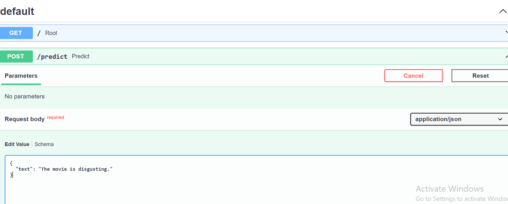
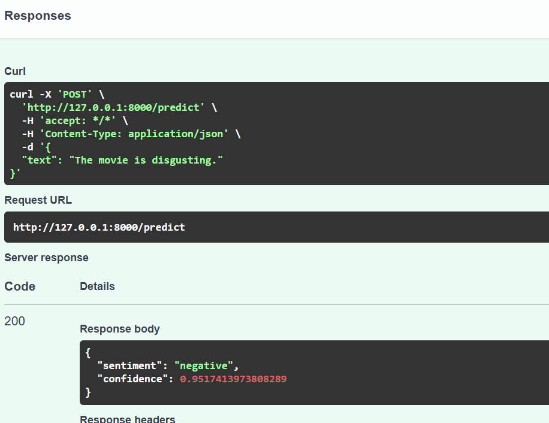
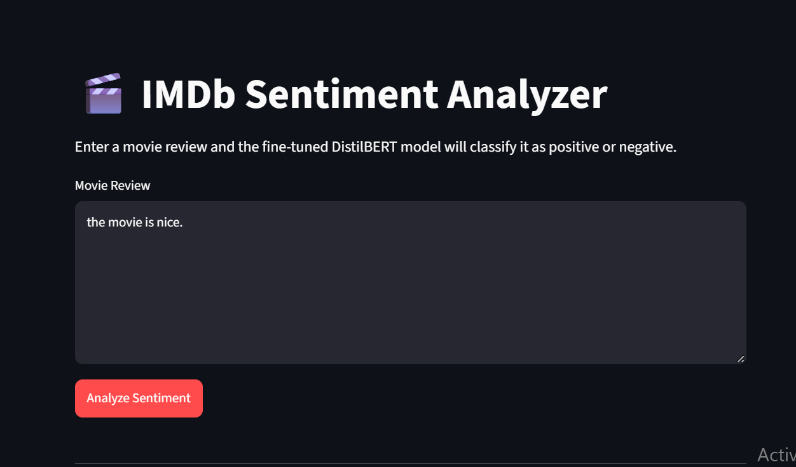
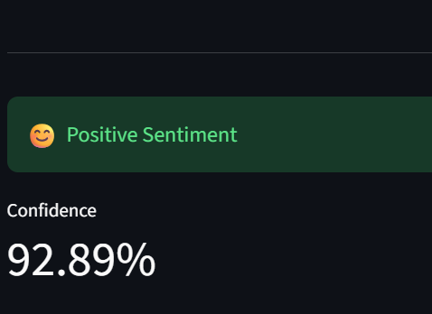

# 🎬 IMDb Sentiment Analyzer

A production-style sentiment analysis application built with **Hugging Face Transformers, DistilBERT, PyTorch, FastAPI, and Streamlit**.

The project fine-tunes `distilbert-base-uncased` on the IMDb movie-review dataset and exposes the trained model through a REST API and an interactive Streamlit interface.

---

## 🚀 Project Overview

This project demonstrates an end-to-end NLP machine learning workflow:

```text
IMDb Dataset
      │
      ▼
Data Preprocessing
      │
      ▼
BERT Tokenization
      │
      ▼
DistilBERT Fine-tuning
      │
      ▼
Model Evaluation
      │
      ▼
Saved Transformer Model
      │
      ▼
FastAPI REST API
      │
      ▼
Streamlit Web Interface
```

The application accepts a movie review and predicts whether the review expresses **positive** or **negative** sentiment.

---

## ✨ Features

* IMDb movie-review sentiment classification
* DistilBERT fine-tuning using Hugging Face Transformers
* Text tokenization with a pretrained BERT tokenizer
* Accuracy, precision, recall, and F1 evaluation
* Confusion matrix visualization
* REST API using FastAPI
* Interactive frontend using Streamlit
* Confidence score returned by the model
* Modular training, evaluation, API, and frontend components

---
## Screenshots







---

## 🧠 Model

### Base Model

```text
distilbert-base-uncased
```

The pretrained DistilBERT model is adapted for binary sequence classification:

```text
LABEL_0 → Negative
LABEL_1 → Positive
```

### Training Configuration

| Parameter               |                     Value |
| ----------------------- | ------------------------: |
| Base model              | `distilbert-base-uncased` |
| Training samples        |                     2,000 |
| Validation samples      |                       500 |
| Epochs                  |                         1 |
| Learning rate           |                    `2e-5` |
| Batch size              |                         8 |
| Maximum sequence length |                       256 |
| Random seed             |                        42 |
| Training device         |                       CPU |

The training subset was intentionally limited because the model was trained locally on CPU.

---

## 📊 Evaluation

The final model was evaluated on a randomly shuffled sample of **1,000 IMDb test reviews**.

### Test Dataset

| Class    | Samples |
| -------- | ------: |
| Negative |     512 |
| Positive |     488 |
| Total    |   1,000 |

### Results

| Metric    |      Score |
| --------- | ---------: |
| Accuracy  | **85.80%** |
| Precision | **82.89%** |
| Recall    | **89.34%** |
| F1 Score  | **86.00%** |

### Confusion Matrix

```text
                  Predicted
                 Negative  Positive

Actual Negative     422       90
Actual Positive      52      436
```

The model correctly classified **858 of the 1,000 test reviews**.

> **Note:** These results come from a CPU-trained experiment using 2,000 training examples rather than the complete IMDb training set. They should therefore be interpreted as an experimental baseline rather than a full-dataset benchmark.

---

## 📈 Validation Results

During training, the model achieved the following validation performance:

| Metric    | Validation Score |
| --------- | ---------------: |
| Accuracy  |           88.20% |
| Precision |           85.87% |
| Recall    |           91.67% |
| F1 Score  |           88.68% |

The independent test evaluation is used as the primary performance result.

---

## 🛠️ Tech Stack

### Machine Learning

* Python
* PyTorch
* Hugging Face Transformers
* Hugging Face Datasets
* Scikit-learn
* NumPy

### Model

* DistilBERT
* BERT tokenizer
* Sequence classification

### Backend

* FastAPI
* Uvicorn
* Pydantic

### Frontend

* Streamlit
* Requests

### Evaluation

* Accuracy
* Precision
* Recall
* F1 Score
* Confusion Matrix
* Matplotlib

---

## 📁 Project Structure

```text
sentiment-analyzer/
│
├── training/
│   ├── train.py
│   └── evaluate.py
│
├── model/
│   └── sentiment_model/
│       ├── config.json
│       ├── model.safetensors
│       ├── tokenizer.json
│       ├── tokenizer_config.json
│       └── ...
│
├── api/
│   ├── main.py
│   └── schemas.py
│
├── frontend/
│   └── streamlit_app.py
│
├── evaluation_results.png
├── requirements.txt
├── .gitignore
└── README.md
```

---

# ⚙️ Installation

## 1. Clone the repository

```bash
git clone <YOUR_GITHUB_REPOSITORY_URL>
cd sentiment-analyzer
```

## 2. Create a virtual environment

Python 3.12 was used for the project.

### Windows

```powershell
py -3.12 -m venv .venv312
```

Activate it:

```powershell
.\.venv312\Scripts\Activate.ps1
```

## 3. Install dependencies

```powershell
pip install -r requirements.txt
```

---

# 🏋️ Training

The training script downloads the IMDb dataset, creates a validation split, tokenizes the reviews, fine-tunes DistilBERT, evaluates the validation set, and saves the trained model.

Run:

```powershell
python training/train.py
```

The trained model is saved to:

```text
model/sentiment_model/
```

---

# 📊 Evaluation

Run the independent evaluation pipeline:

```powershell
python training/evaluate.py
```

The script reports:

* Accuracy
* Precision
* Recall
* F1 Score
* Classification report
* Confusion matrix

It also generates:

```text
evaluation_results.png
```

---

# 🚀 Running the FastAPI Backend

Start the API from the project root:

```powershell
uvicorn api.main:app --reload
```

The API will be available at:

```text
http://127.0.0.1:8000
```

Interactive API documentation:

```text
http://127.0.0.1:8000/docs
```

---

# 🔮 API Usage

## Endpoint

```text
POST /predict
```

### Request

```json
{
  "text": "This movie was absolutely fantastic. I loved every minute of it!"
}
```

### Response

```json
{
  "sentiment": "positive",
  "confidence": 0.9374
}
```

The API returns:

* `sentiment`
* `confidence`

---

# 🖥️ Running the Streamlit Application

Make sure the FastAPI server is running first.

Then open another terminal and activate the environment:

```powershell
.\.venv312\Scripts\Activate.ps1
```

Run:

```powershell
streamlit run frontend/streamlit_app.py
```

Streamlit will provide a local URL, typically:

```text
http://localhost:8501
```

The interface allows users to:

1. Enter a movie review.
2. Send the review to the FastAPI backend.
3. Receive the predicted sentiment.
4. View the model confidence.

---

# 🔍 Example

### Input

```text
This movie was amazing. The acting was excellent and the story was very engaging.
```

### Output

```text
Positive Sentiment

Confidence: 93.74%
```

---

# 🧪 Development Workflow

The project follows a modular machine learning workflow:

```text
1. Load Dataset
       ↓
2. Split Training / Validation
       ↓
3. Tokenize Text
       ↓
4. Fine-tune DistilBERT
       ↓
5. Save Model
       ↓
6. Independently Evaluate
       ↓
7. Serve Model with FastAPI
       ↓
8. Build Streamlit Interface
```

This separation makes the project easier to maintain and extend.

---

# 🔮 Future Improvements

Possible improvements include:

* Train on the complete IMDb training dataset
* Increase training epochs
* Hyperparameter tuning
* GPU-based training
* Experiment with learning-rate schedules
* Compare DistilBERT with BERT and RoBERTa
* Add batch prediction
* Add probability visualization
* Add API authentication
* Add automated tests
* Add CI/CD
* Deploy the FastAPI backend
* Deploy the Streamlit frontend
* Publish the trained model to Hugging Face Hub
* Add experiment tracking with MLflow

---

# 📌 Limitations

The current implementation is intentionally a lightweight CPU-based experiment.

The model was fine-tuned using:

```text
2,000 training examples
500 validation examples
1,000 test examples
```

Therefore, the reported **85.80% test accuracy** should not be compared directly with results obtained from models trained on the complete IMDb training dataset.

---

# 👨‍💻 Author

**Arpan Neupane**

Computer Engineering Graduate | AI/ML | NLP | Transformers | RAG

GitHub:
https://github.com/arpanneupane75

---

## ⭐ Project Highlights

This project demonstrates practical experience with:

```text
Hugging Face Transformers
        +
Transfer Learning
        +
NLP Classification
        +
PyTorch
        +
Model Evaluation
        +
FastAPI
        +
Streamlit
```

It was developed as an end-to-end machine learning application rather than only a model-training notebook.
